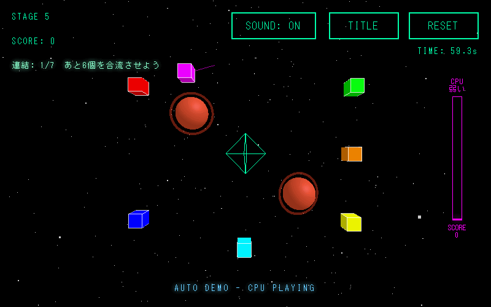

# Comet Gravity

宇宙に散らばったブロックをドラッグでくっつけて1つの塊にし、中央のアンカーまで運ぶ3D物理パズルゲーム。

遊ぶ: https://kouogu13-star.github.io/comet-gravity-play/

## 操作

| 操作 | 内容 |
|---|---|
| 左クリック＋ドラッグ | ブロックを動かす。近づけると自動で連結し、連結した塊はまとめて動く |
| 右クリック＋ドラッグ（ブロックの上） | ブロックを回転 |
| マウスホイール | 拡大・縮小 |

## 遊び方

- 全部のブロックを1つにつないで、中央のアンカーまで運ぶとクリア
- 惑星に触れ続けると墜落する（難易度で猶予が変わる）
- モードはチュートリアル／タイムアタック。難易度は5段階。全9ステージ＋条件を満たすと出る裏ステージ
- ステージエディター、記録・実績・リプレイ、CPU が自分で解く AUTO DEMO もある

## 使用技術

HTML / CSS / JavaScript、three.js r128（描画）、cannon.js 0.6.2（物理演算）、Web Audio API（効果音）。ビルド不要の HTML 1枚。

記録とエディターで作ったステージは、このブラウザの中（localStorage）にだけ保存される。
